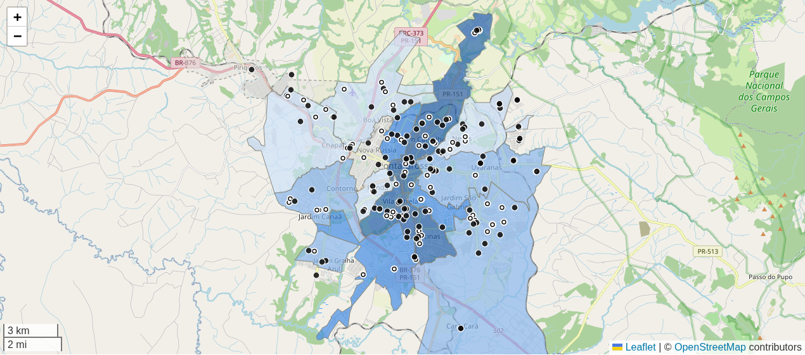

# Aluguéis de casas em Ponta Grossa

Sistema que coleta anúncios públicos de casas para alugar em Ponta Grossa (PR), mostra o mercado num mapa por
bairro e estima o aluguel de uma casa a partir do local e das características.



## Como rodar
Requer **Python 3.12 ou superior**.

**1. Instalar** (só na primeira vez, na pasta do projeto):
```bash
python3 -m venv .venv               # no Windows: python -m venv .venv
source .venv/bin/activate          # no Windows: .venv\Scripts\activate
pip install -r requirements-tested.txt
pip install -e .
```

**2. Abrir o app:**
```bash
source .venv/bin/activate          # se o terminal for novo
python -m imoveis_pg demo
```
Depois abra **http://localhost:8501** no navegador. Para encerrar, use Ctrl+C no terminal.

- **Na primeira vez**, o `demo` coleta os anúncios nos sites das imobiliárias, baixa os dados do IBGE, treina os
  modelos e abre o app. Leva cerca de 4 minutos e precisa de internet.
- **Nas próximas vezes**, ele reaproveita o que já existe em `data/` e abre o app na hora.
- Para coletar anúncios novos (de hoje): `python -m imoveis_pg demo --atualizar`.
- Se uma etapa falhar (por exemplo, sem internet), rode o `demo` de novo: o que já foi concluído não é refeito.

**No app:**
- **Mapa do mercado:** aluguel mediano por bairro, anúncios e filtros (tipo, bairro, preço, quartos).
- **Simulador:** clique no mapa, informe as características da casa e veja o aluguel estimado com intervalo, a faixa
  de preço, casas parecidas anunciadas e avisos de confiabilidade.
- **Qualidade dos dados** e **Sobre e limitações**.

## O que o projeto faz
| Etapa | Como | Documentação |
|---|---|---|
| Coleta | Anúncios públicos de 4 imobiliárias, respeitando `robots.txt`, sem dados pessoais | [coleta.md](docs/coleta.md) |
| Localização | Geocodificação offline com o CNEFE 2022 e 16 bairros oficiais (IBGE) | [coleta.md](docs/coleta.md), [dados.md](docs/dados.md) |
| Qualidade e EDA | Padronização, duplicatas, extremos, distribuições e comparação por bairro | [dados.md](docs/dados.md) |
| Agrupamento | K-means, Ward e DBSCAN: perfis de casas e concentrações de oferta | [agrupamento.md](docs/agrupamento.md) |
| Classificação | Faixas de aluguel: árvore, KNN, SVM e MLP contra baselines | [classificacao.md](docs/classificacao.md) |
| Regressão | Valor em reais: linear, árvore, KNN, SVR e MLP, com intervalo de 80% | [regressao.md](docs/regressao.md) |
| App | Mapa, filtros e simulador em Streamlit | [app.md](docs/app.md) |

O [relatório técnico](docs/relatorio_tecnico.md) reúne métodos, resultados e limitações.

## Comandos individuais
O `demo` só encadeia os comandos abaixo. Use-os para refazer uma etapa ou reproduzir os resultados do relatório
(todos aceitam `--help`):

| Comando | Faz |
|---|---|
| `collect FONTE --output CSV` | Coleta uma imobiliária (`torreblanca`, `portaldez`, `granada`, `vilanova`) |
| `merge CSV... --output CSV` | Une as fontes numa base única |
| `analyze CSV --output PASTA --bairros GPKG` | Relatório de qualidade e EDA |
| `cluster CSV --output PASTA` | Agrupamento |
| `classify CSV --output PASTA --repeticoes 10` | Classificação com estabilidade entre partições |
| `regress CSV --output PASTA --repeticoes 10` | Regressão com estabilidade entre partições |
| `export-base CSV --output CSV` | Base processada pública, sem endereço |
| `build-app CSV --output PASTA` | Treina os modelos do app |
| `app --artefatos PASTA` | Abre o app com modelos já treinados |

A sequência completa que gerou os números do relatório está no
[Apêndice A do relatório técnico](docs/relatorio_tecnico.md#apêndice-a-reprodução). Cada saída grava sementes,
parâmetros, versões e o SHA-256 da entrada num `manifest.json`, e nenhuma saída existente é sobrescrita.

**Testes:** `pip install -e ".[dev]"` e depois `python -m pytest -q`.

## Dados
- Os dados coletados ficam em `data/` e **não vão para o git**. As páginas brutas contêm nomes de corretores e nunca
  devem ser publicadas.
- A única exceção é a base processada pública `data/processado/base_2026-11-09.csv`: 236 anúncios, sem endereço,
  com coordenadas arredondadas a ~100 m ([data/README.md](data/README.md)).
- Todas as colunas estão descritas no [dicionário de dados](docs/dicionario.md).

## Limitações
- Estima o aluguel **anunciado** por quatro imobiliárias, não o preço negociado; não é avaliação imobiliária oficial.
- Com cerca de 200 casas, as estimativas são aproximadas: o erro médio da regressão é de ~31%, e a faixa acerta
  cerca de 2 em cada 3 casas.
- Coordenadas sem número exato são aproximadas (rua, CEP ou bairro) e marcadas como tais.
- Bairros com menos de 5 anúncios são indicados como de baixa confiabilidade.

## Desenvolvimento
[Cronograma, decisões e pendências](docs/gestao.md) · [escopo inicial](docs/proposta-inicial.md) ·
[contrato de dados](docs/dados.md). Commits seguem Conventional Commits.
