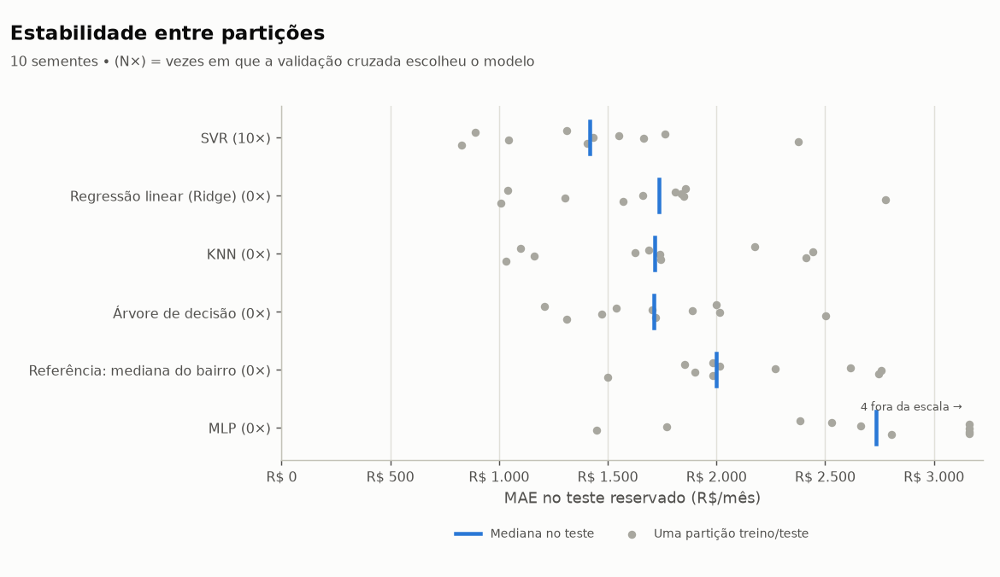
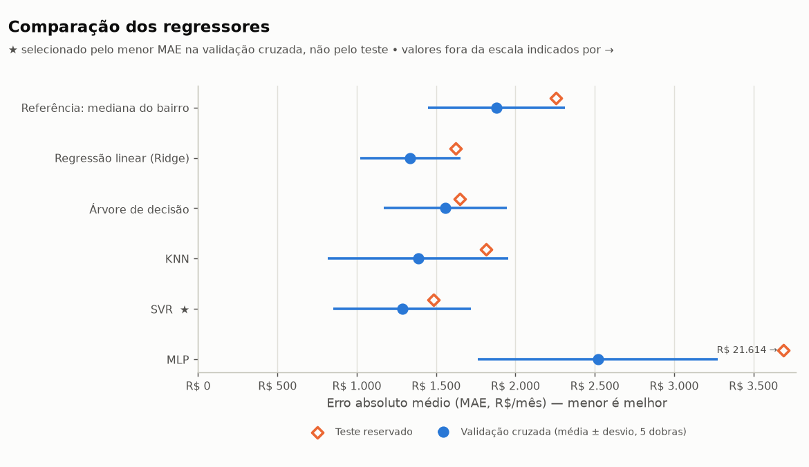
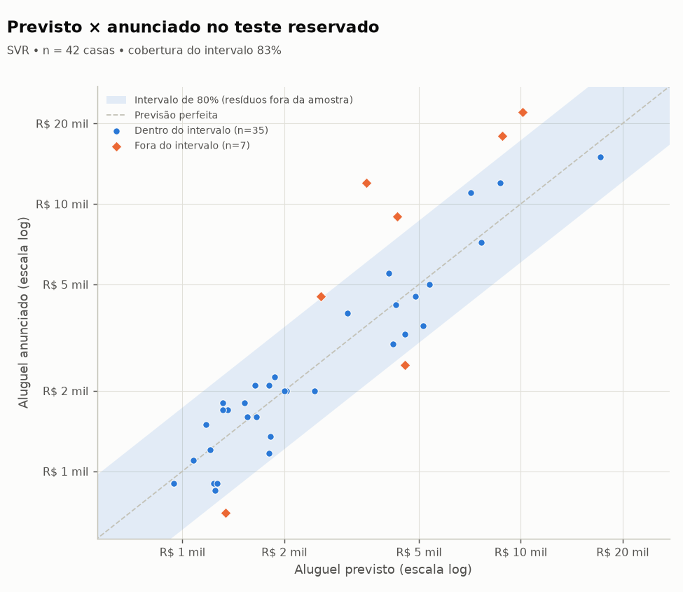
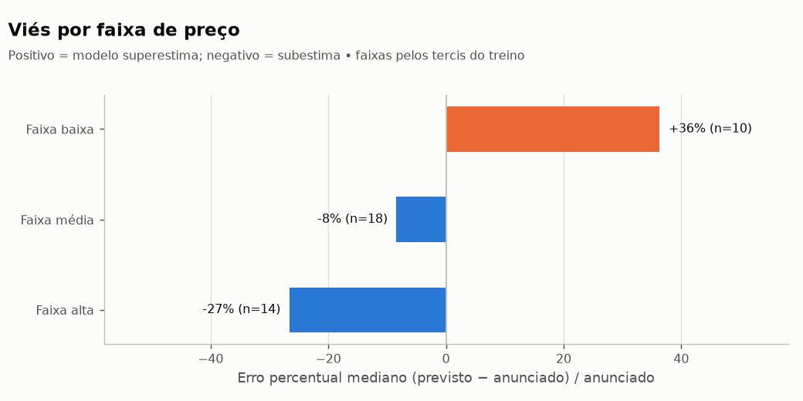

# Regressão do aluguel em reais

## Pergunta
Qual o aluguel mensal anunciado provável de uma casa, em reais, dadas as características e a localização?
O fluxo final do AGENTS.md pede que o software retorne "o valor estimado"; a apostila trata a regressão como
obrigatória ou ampliação, conforme a turma (seção 9.3). Ela complementa a [classificação por faixas](classificacao.md).

## Executar
```bash
python -m imoveis_pg regress data/base_2026-11-09.csv --output reports/regressao-2026-11-09 --repeticoes 10
```
Opções: `--seed` (padrão 42), `--repeticoes` (repete o experimento inteiro com as sementes 0..N−1; cerca de
1 min cada) e `--bairros`.

Saídas:
- `metricas.csv`;
- `erros_teste.csv`, `erros_por_bairro.csv` e `erros_por_faixa.csv`;
- `comparacao_modelos.png`, `previsto_x_anunciado.png` e `vies_por_faixa.png`;
- `estabilidade.{csv,png}` e `estabilidade_execucoes.csv`;
- `modelo_selecionado.joblib`;
- `manifest.json`.

## Método
Mesmo protocolo sem vazamento da classificação:
- **Partição:** 208 casas, mesmos atributos (nada derivado do aluguel), teste reservado de 20% separado por grupo de
  imóvel e `GridSearchCV` com `GroupKFold` de 5 dobras só no treino.
- **Alvo:** `log(aluguel)`. Os aluguéis são muito assimétricos (média R$ 3.792; mediana R$ 2.050), e o log evita
  que poucas casas de luxo dominem o ajuste, como recomenda a seção 19 da apostila. As previsões voltam para reais
  (`TransformedTargetRegressor`) antes de qualquer métrica.
- **Métricas, todas em reais:**
  - **MAE** (erro absoluto médio): principal, porque é em reais e fácil de explicar;
  - **MAPE** (erro percentual médio): compara casas baratas e caras na mesma escala;
  - **RMSE**: pune erros grandes;
  - **R²**;
  - erro mediano.
- **Seleção:** menor MAE médio na validação cruzada, nunca pelo teste.
- **Intervalo de previsão de 80%:**
  - calculado com os quantis 10% e 90% dos resíduos `log(real/previsto)` de previsões fora da amostra no treino;
  - aplicado como multiplicadores sobre a previsão;
  - **cobertura verificada no teste reservado**, como exigia a [proposta inicial](proposta-inicial.md) antes de
    exibir intervalos.

| Modelo | Hiperparâmetros testados |
|---|---|
| Referência: mediana do bairro | — (aluguel mediano do bairro no treino) |
| Regressão linear (Ridge) | `alpha` ∈ {0,1; 1; 10} |
| Árvore de decisão | `max_depth` ∈ {3, 5, 8, ∞}; `min_samples_leaf` ∈ {1, 3, 5, 10} |
| KNN | `n_neighbors` ∈ {3, 5, 7, 11, 15}; `weights` ∈ {uniform, distance} |
| SVR (RBF) | `C` ∈ {0,1; 1; 10; 100}; `gamma` ∈ {scale; 0,01; 0,1}; `epsilon` ∈ {0,05; 0,1} |
| MLP | camadas ∈ {(16), (32), (32, 16)}; `alpha` ∈ {0,0001; 0,01; 1} |

## Resultados (base de 2026-11-09)
### Estabilidade em 10 partições (sementes 0 a 9)
| Modelo | MAE na CV | MAE no teste: média ± dp | MAPE no teste | R² no teste | Escolhido |
|---|---|---|---|---|---|
| **SVR** | **R$ 1.279** | **R$ 1.426 ± 458** | **31%** | **0,58** | **10×** |
| Regressão linear | R$ 1.411 | R$ 1.672 ± 508 | 37% | 0,43 | 0× |
| KNN | R$ 1.479 | R$ 1.713 ± 516 | 36% | 0,44 | 0× |
| Árvore de decisão | R$ 1.502 | R$ 1.736 ± 384 | 42% | 0,42 | 0× |
| Referência: mediana do bairro | R$ 2.014 | R$ 2.163 ± 422 | 65% | 0,23 | — |
| MLP | R$ 8.716 | R$ 25.565 ± 35.636 | 156% | −2.947 | 0× |



- **O SVR é a escolha clara:** foi escolhido pela validação cruzada em todas as 10 partições e superou a referência
  por bairro no teste em todas elas. O erro percentual cai de 65% (só o bairro) para 31%.
- **O intervalo de 80% está calibrado em média:** cobriu 81% das casas do teste, variando de 65% a 96% entre
  partições por causa do teste pequeno. É largo, porém: a previsão × 0,64 a × 1,67 no modelo do app. Para uma
  previsão de R$ 2.000, isso vai de cerca de R$ 1.280 a R$ 3.340.
- **O MLP é instável:** com o alvo em log, pequenas extrapolações viram valores absurdos quando voltam para reais
  (num teste, MAE de R$ 21.614). Registramos o resultado em vez de esconder o modelo; ele não deve ser usado.

### Partição principal (semente 42; 42 casas no teste)



| Modelo | MAE na CV (± dp) | MAPE na CV | R² na CV | MAE no teste | RMSE no teste | MAPE no teste | R² no teste |
|---|---|---|---|---|---|---|---|
| Referência: mediana do bairro | R$ 1.881 ± 433 | 63% | 0,20 | R$ 2.254 | R$ 4.108 | 57% | 0,30 |
| Regressão linear | R$ 1.337 ± 314 | 37% | 0,51 | R$ 1.621 | R$ 3.277 | 30% | 0,55 |
| Árvore de decisão | R$ 1.558 ± 387 | 45% | 0,45 | R$ 1.649 | R$ 3.158 | 37% | 0,59 |
| KNN | R$ 1.387 ± 569 | 35% | 0,52 | R$ 1.817 | R$ 3.359 | 34% | 0,53 |
| **SVR** | **R$ 1.287 ± 433** | **34%** | **0,56** | **R$ 1.483** | **R$ 2.971** | **28%** | **0,63** |
| MLP | R$ 2.519 ± 755 | 58% | −1,27 | R$ 21.614 | R$ 129.270 | 130% | −693 |

Hiperparâmetros do SVR: `C = 10`, `gamma = 0,01`, `epsilon = 0,05`. O intervalo cobriu 35 das 42 casas (83%).



### Resíduos por faixa de preço e por região
Faixas pelos tercis do treino (baixa ≤ R$ 1.450; média até R$ 3.800; alta acima):

| Faixa real | n | MAE | MAPE | Viés mediano |
|---|---|---|---|---|
| baixa | 10 | R$ 297 | 32% | **+36%** (superestima) |
| média | 18 | R$ 566 | 23% | −8% |
| alta | 14 | R$ 3.509 | 30% | **−27%** (subestima) |



- **Regressão à média:** o modelo puxa as casas baratas para cima e as caras para baixo. Em reais, o erro cresce com o preço
  (R$ 297 na faixa baixa, R$ 3.509 na alta); em porcentagem, a faixa média é a mais bem estimada (23%).
- **As maiores surpresas são casas especiais:**
  - Boa Vista, 60 m², anunciada a R$ 700 e prevista em R$ 1.342 (+92%);
  - Cara Cara, 230 m², R$ 2.500 contra R$ 4.545 previstos (+82%);
  - Jardim Carvalho, sem área informada, R$ 12.000 contra R$ 3.492 (−71%);
  - Centro, 760 m², R$ 22.000 contra R$ 10.117 (−54%).
  São candidatas a anúncio incorreto, imóvel atípico ou atributo ausente, como prevê a seção 9.4 da apostila.
- **Por bairro:** no teste da semente 42, entre os bairros com 2 ou mais casas, Contorno (9%) e Olarias (12%) foram
  os mais bem estimados e Boa Vista (59%) e Centro (53%) os piores. Com 1 a 8 casas por bairro no teste, essas
  diferenças são indicativas, não conclusivas (`erros_por_bairro.csv`).

## No app
O `build-app` reajusta o SVR nas 208 casas (hiperparâmetros por `GroupKFold`) e mede, com previsões fora da
amostra nas mesmas dobras, o erro do modelo e o da referência por bairro:

| | MAE | MAPE | R² |
|---|---|---|---|
| SVR | R$ 1.201 | 32% | 0,67 |
| Mediana do bairro | R$ 2.039 | 64% | 0,21 |

Como o modelo supera a referência, **o simulador mostra o aluguel estimado com o intervalo de 80%** ao lado da
faixa do classificador e das casas parecidas. Se um dia o modelo não superar a referência, o valor fica oculto.

O app avisa quando o valor cai **mais de 10% fora** da faixa prevista pelo classificador. Perto da divisa entre
faixas a diferença é ruído: um valor de R$ 1.544 com a faixa "baixa" (até R$ 1.500) não gera aviso. Os popups do mapa
mostram o aluguel estimado fora da amostra de cada casa anunciada.

## Limitações
- MAPE de cerca de 31% e intervalos largos: com 208 casas e atributos incompletos, a estimativa serve como ordem de
  grandeza, não como avaliação.
- A cobertura do intervalo oscila entre partições (65% a 96%), e o intervalo é o mesmo multiplicador para casas
  baratas e caras, embora o erro relativo dependa da faixa.
- O viés por faixa (+36% nas baratas, −27% nas caras) indica que faltam atributos que distinguem padrão de
  acabamento, estado de conservação e lazer (piscina, área gourmet), que as fontes informam de forma irregular.
- Aluguel anunciado, não negociado; quatro imobiliárias numa única data.
