# Mapeamento e estimativa de aluguéis de casas em Ponta Grossa (PR)

**Relatório técnico** · Projeto Integrador · Aprendizagem de Máquina · Engenharia de Software · IFPR
**Autor:** Luan Gustavo (trabalho individual) · **Base de dados:** coleta de 2026-11-09 · **Versão do relatório:** 2026-11-16

---

## Resumo
Este trabalho constrói um sistema que coleta anúncios públicos de casas para alugar em Ponta Grossa (PR), trata
e georreferencia os dados, analisa a distribuição espacial dos aluguéis e estima a **faixa** e o **valor do aluguel** de uma casa a
partir do local e das características. Foram coletados 236 anúncios de quatro imobiliárias locais, dos quais
208 casas residenciais formam a base dos modelos. Anúncios sem coordenadas foram geocodificados offline com o
Cadastro Nacional de Endereços (CNEFE 2022, IBGE) e atribuídos aos 16 bairros oficiais da malha do Censo 2022.
Na classificação em três faixas de aluguel, MLP e SVM tiveram o melhor desempenho (balanced accuracy média de
0,66 e 0,65 no teste, em 10 partições), contra 0,54 de um baseline que usa só o bairro e 0,33 do acaso. Na
regressão do valor em reais, o SVR foi escolhido em todas as 10 partições e errou em média R$ 1.426 (31%), contra
R$ 2.163 (65%) da mediana do bairro; seu intervalo de previsão de 80% cobriu 81% das casas do teste. O
agrupamento revelou três perfis de casas (compactas, familiares e de alto padrão), que se distinguem mais pelo
tamanho do que pelo preço por metro quadrado. O protótipo em Streamlit mostra o mapa do mercado com filtros e um
simulador em que o usuário clica no mapa e recebe o aluguel estimado com intervalo, a faixa, casas parecidas e
avisos de confiabilidade.

---

## 1. Introdução e contextualização
O preço de um imóvel depende das suas características e da localização: casas semelhantes podem ter aluguéis
bem diferentes em bairros distintos. Os anúncios, porém, ficam dispersos entre imobiliárias, com formatos,
nomes de bairro e níveis de detalhe diferentes, e não há uma visão integrada da cidade. Este projeto reúne esses
anúncios numa base única, georreferenciada e auditável, e usa aprendizagem de máquina para descrever o mercado e
estimar faixas de aluguel, deixando explícitos os limites do que os dados permitem afirmar.

## 2. Objetivos e delimitação do escopo
**Objetivo geral:** analisar a distribuição espacial dos aluguéis de casas em Ponta Grossa e produzir
estimativas, agrupamentos e classificações que ajudem a compreender o mercado local.

**Objetivos específicos:**
- montar uma base de anúncios com localização;
- limpar, padronizar e integrar fontes diferentes;
- calcular indicadores por região;
- representá-los em mapas;
- identificar perfis por agrupamento;
- classificar casas em faixas de preço, comparando modelos com validação adequada;
- discutir limitações e vieses.

**Delimitação:**

| Dimensão | Escolha |
|---|---|
| Cidade | Ponta Grossa (PR) |
| Tipo de imóvel | Casas, incluindo sobrados e casas em condomínio |
| Finalidade | Locação |
| Uso | Residencial nos modelos; imóveis comerciais aparecem no mapa, com filtro |
| Alvo | Aluguel mensal **anunciado** (não o negociado); condomínio e IPTU são custos separados |

## 3. Fontes e conjunto de dados
### 3.1 Fontes
| Fonte | Anúncios | Localização | Coleta |
|---|---|---|---|
| Torre Blanca Imóveis | 115 | Coordenadas do próprio anúncio | 6 páginas de busca |
| Portal Dez Imóveis | 109 | Geocodificada (rua, número e CEP) | 24 páginas |
| Vila Nova Imobiliária | 8 | Geocodificada | 2 páginas |
| Imobiliária Granada | 4 | Geocodificada | 2 páginas |
| **Total** | **236** | 113 exatas, 95 aproximadas (casas do modelo) | 2026-11-09 |

Dados de referência do IBGE: **CNEFE 2022** de Ponta Grossa (178.567 endereços com coordenadas) e a
**malha de bairros do Censo 2022** (16 bairros).

### 3.2 Conduta da coleta
A coleta automatizada (seção 5 da apostila) foi feita só onde é técnica e juridicamente permitida:
- apenas páginas públicas de busca, depois de verificar o `robots.txt` de cada site;
- 3 segundos entre requisições, com user-agent que identifica o projeto acadêmico;
- cache local das páginas, para reprocessar sem acessar o site de novo;
- **nenhum dado de corretor, descrição livre, telefone ou foto é copiado**; o endereço fica só na base local e
  nunca aparece no app.

Os serviços de geocodificação on-line avaliados (Nominatim, Photon, Overpass e BrasilAPI) bloqueiam a busca
no `robots.txt`, por isso a geocodificação usa o CNEFE, que é dado aberto e roda offline. Detalhes em
[coleta.md](coleta.md).

### 3.3 Atributos
O [dicionário de dados](dicionario.md) descreve todas as colunas. Principais atributos e preenchimento na base:
aluguel (100%), área (79%), quartos (79%), banheiros (78%), vagas (67%), suítes (31%), IPTU (75%) e condomínio (14%).
**Nenhuma fonte informa a periodicidade do IPTU**, por isso o custo mensal total não pôde ser calculado.

## 4. Metodologia de preparação e análise
O pipeline é reprodutível por linha de comando (seção 12) e segue as oito etapas da seção 6 da apostila:

1. **Inspeção:** relatório de qualidade com dimensões, tipos, ausências, duplicidades e estatísticas (`quality.json`).
2. **Padronização:**
   - valores em reais ("R$ 1.234,56") e área ("80 m²") convertidos para número;
   - bairros unificados nos 16 oficiais: 37 grafias diferentes, como "CARÁ-CARÁ", "Cará- Cará" e "Colônia Dona Luzia";
   - o valor original de cada célula é preservado ao lado do convertido.
3. **Ausentes:**
   - nenhuma ausência vira zero na base;
   - nos modelos, imputação pela mediana com **indicador de ausência**, ajustada só no treino;
   - suítes ausentes são tratadas como informação: nenhum anúncio informa "0 suítes", e as casas sem o campo
     têm aluguel mediano de R$ 1.600, contra R$ 5.000 das que têm suíte. As medianas por imobiliária são
     parecidas (R$ 1.900 a R$ 2.100), então o efeito não vem da fonte.
4. **Extremos:** 40 valores sinalizados pelo critério IQR (1,5 × amplitude interquartil) e **mantidos**, porque
   correspondem a casas grandes e caras plausíveis. O agrupamento usa o log do aluguel e da área, e as métricas
   de classificação são robustas ao desbalanceamento.
5. **Codificação:** one-hot de bairro e subtipo (casa, sobrado, casa em condomínio).
6. **Normalização:** padronização (média 0, desvio 1) dos atributos numéricos, ajustada só no treino.
7. **Engenharia de atributos:**
   - aluguel/m² e custo mensal total, **só analíticos, nunca preditores**;
   - distância ao centro;
   - bairro oficial;
   - "tem suíte".
8. **Separação dos dados:**
   - teste reservado de 20%, separado por **grupo de imóvel**;
   - limites das faixas, imputação e escalas ajustados só no treino.

**Qualidade da geocodificação.** A cascata de busca vai do número exato até o centro do bairro. Para medir o
erro, os 115 endereços da Torre Blanca (que têm coordenadas) foram geocodificados e comparados:

| Método | Erro mediano |
|---|---|
| Número exato | 74 m |
| CEP | 200 m |
| Rua e CEP | 520 m |
| Centro do bairro | ~2,9 km |

A inspeção espacial (figura abaixo) revelou e corrigiu dois erros: um CEP genérico dos Correios (sufixo 970), que jogava sete casas
num ponto rural, e um CEP de outra região, que deslocava anúncios em 7,7 km. Resultados que caem a mais de 1 km do
bairro declarado passaram a recuar para o bairro.

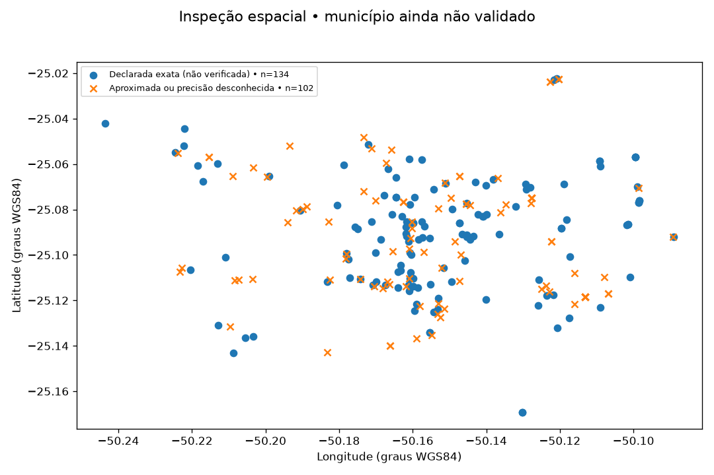

**Duplicatas.**
- Um mesmo imóvel pode estar anunciado por duas imobiliárias, e uma delas omite o número da casa.
- A detecção compara logradouro sem número, área e quartos: **11 anúncios** sinalizados.
- Também ficam no mesmo grupo anúncios com mesmo bairro, área, quartos e aluguel, como **7 casas idênticas de
  um empreendimento**.
- Isso impede que o modelo acerte o teste por memorização.

## 5. Análise exploratória
A EDA abrange os 236 anúncios de locação (inclusive comerciais); os números entre parênteses referem-se às 208
casas residenciais do modelo.

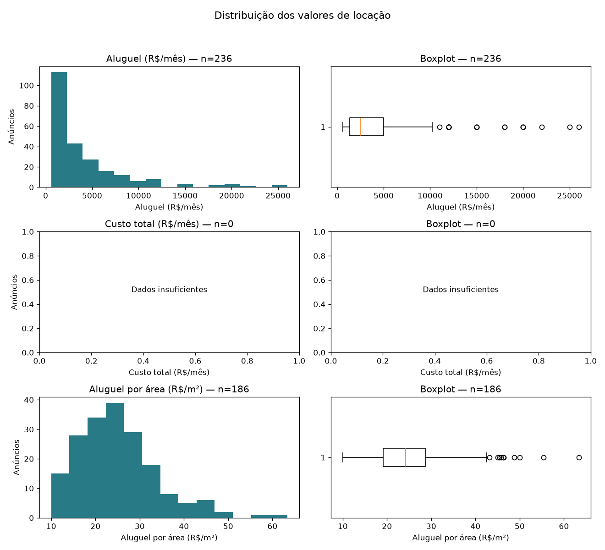

- **Forte assimetria:** aluguel mediano de **R$ 2.050** contra média de R$ 3.792 nas casas (assimetria 2,3). Por
  isso a mediana é o indicador regional do projeto, como recomenda a apostila. O aluguel por m² é menos
  assimétrico: mediana de R$ 24,00/m², quartis de R$ 19,20 a R$ 28,30.
- **Área e preço:** o aluguel tem correlação de 0,87 com a área (n = 186 pares), 0,75 com banheiros, 0,70 com
  vagas e 0,58 com quartos.

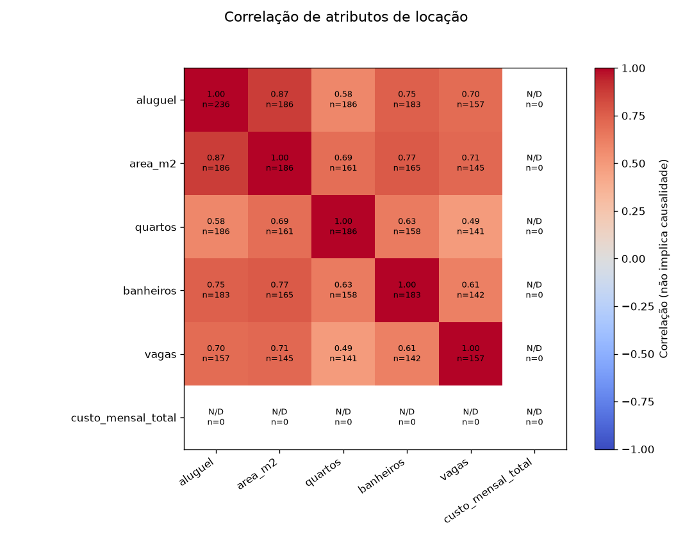

- **Bairros:** o aluguel mediano vai de R$ 1.100 (Neves) a R$ 8.500 (Estrela), e o R$/m² de 15,50 (Chapada) a
  33,30 (Colônia Dona Luíza) e 32,90 (Jardim Carvalho).
- **Variabilidade:** a maior dispersão relativa (desvio/mediana) aparece em Órfãs (2,1), Chapada (1,4), Centro (1,4) e
  Neves (1,3), bairros que misturam casas compactas com imóveis grandes ou comerciais.
- **Contagem por região:** Cara Cara (29), Neves (27), Jardim Carvalho e Uvaranas (25). Nova Rússia e Vila Ildemira
  têm menos de 5 casas e são tratadas como de baixa confiabilidade.

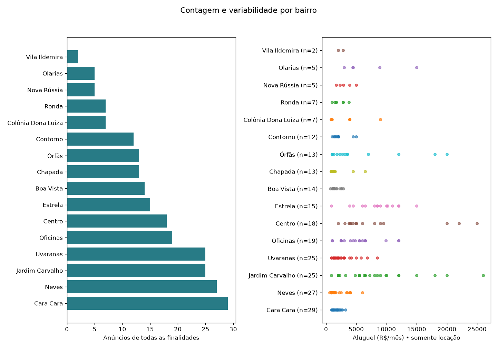

## 6. Agrupamento
**Perfis de casas.**
- Atributos: log da área, quartos, banheiros, tem suíte e log do aluguel, padronizados.
- Amostra: 140 casas com área, quartos e banheiros informados, sem imputação.
- Algoritmos comparados: K-means, hierárquico (Ward) e DBSCAN.
- Critério de escolha: maior silhueta entre as configurações com estabilidade ≥ 0,85. Estabilidade é o ARI médio
  entre o agrupamento da base inteira e o de 50 subamostras de 80%.
- O k = 2 teve a maior silhueta, mas só separa casas pequenas de grandes; não foi escolhido.

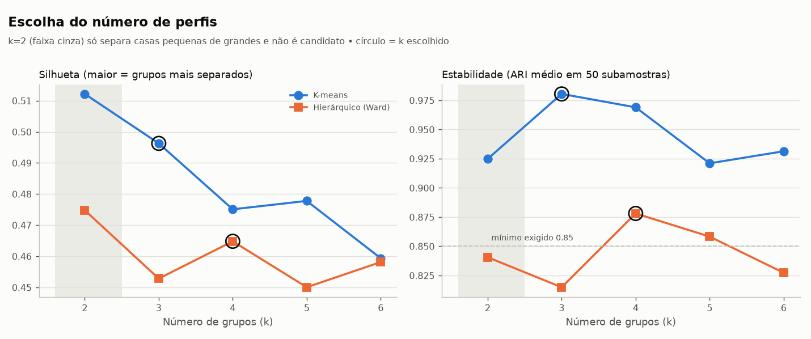

| Perfil (K-means, k = 3; silhueta 0,50; estabilidade 0,98) | n | Aluguel mediano | Área | Com suíte | R$/m² |
|---|---|---|---|---|---|
| 1 · compactas e econômicas | 75 | R$ 1.300 | 60 m² | 1% | 22,5 |
| 2 · familiares intermediárias | 46 | R$ 3.850 | 145 m² | 83% | 27,7 |
| 3 · amplas de alto padrão | 19 | R$ 9.500 | 361 m² | 89% | 25,0 |

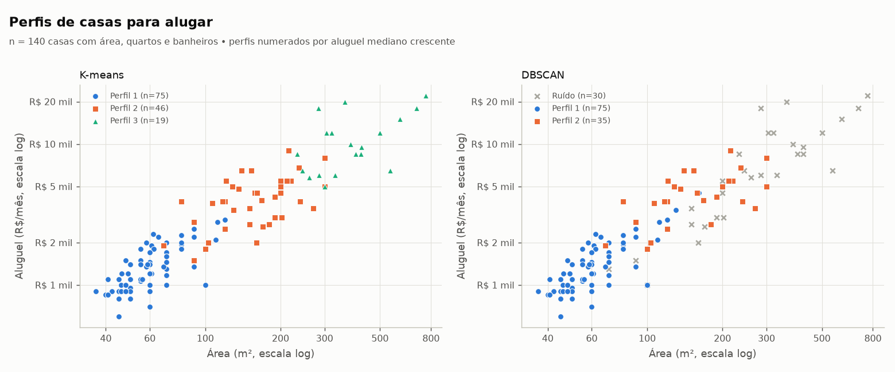

- Os perfis se distinguem pelo **tamanho, não pelo preço do m²**, que é parecido nos três.
- Sem contar o ruído, o DBSCAN concorda com o K-means (ARI 0,93).
- O ruído do DBSCAN contém **todas as casas de alto padrão**: elas são heterogêneas demais para formar um grupo denso.
- O Ward com k = 4 divide o perfil intermediário em casas com e sem suíte.

**Concentrações espaciais.**
- Um DBSCAN geográfico (distância haversine; ≥ 6 anúncios num raio de 600 m) encontrou 11 concentrações de oferta.
- 9 delas ficam quase inteiras dentro de um único bairro, mas um mesmo bairro pode ter polos de preço diferentes:
  em Cara Cara, um polo de R$ 22,50/m² e outro de R$ 27,90/m².
- Uma concentração pode refletir um único empreendimento, e não o tamanho do mercado na região.

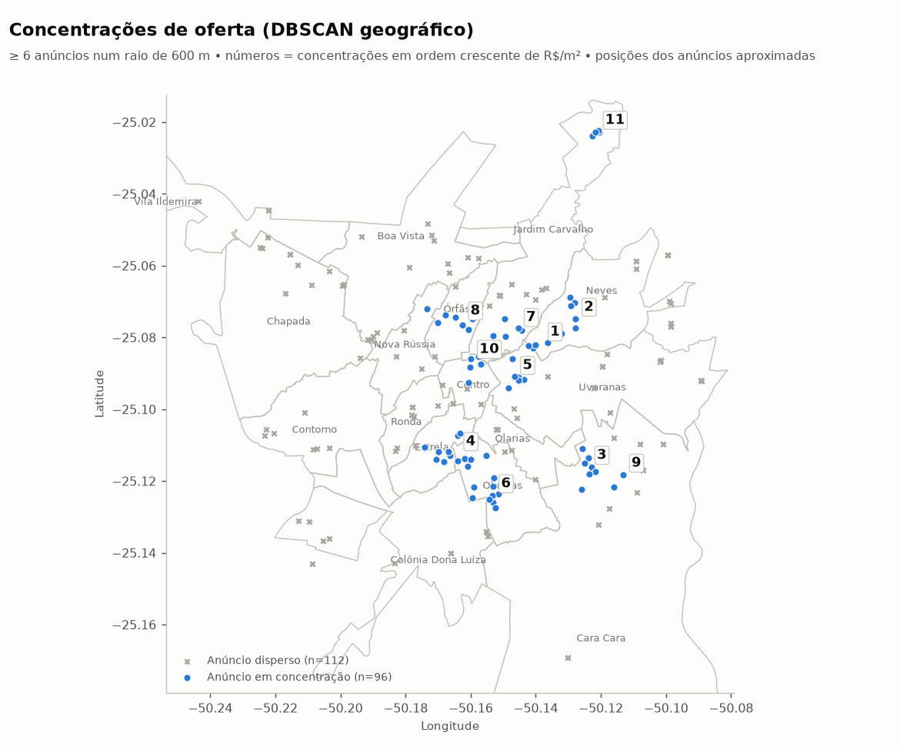

Detalhes em [agrupamento.md](agrupamento.md).

## 7. Classificação
**Tarefa:** prever a faixa de aluguel de uma casa: baixa (até ~R$ 1.450–1.500), média (até ~R$ 3.800) ou alta.
Os limites são os tercis do **treino de cada partição**. Um classificador envelope calcula os limites dentro do
`fit`, de modo que validação e teste nunca influenciam as faixas.

**Atributos:** área, quartos, suítes, banheiros, vagas, latitude, longitude, distância ao centro, bairro oficial
e subtipo. Nada derivado do aluguel.

**Protocolo:**
1. Teste reservado de 20%, separado por grupo de imóvel.
2. Hiperparâmetros por `GridSearchCV` com `GroupKFold` de 5 dobras, só no treino.
3. Seleção pela **balanced accuracy média na validação cruzada**, nunca pelo teste.
4. Dois baselines: classe mais frequente e faixa mais comum do bairro.
5. Como o teste tem só 42 casas, **o experimento inteiro foi repetido com 10 sementes**.

**Métricas:**
- A métrica principal é a balanced accuracy, que dá o mesmo peso a cada faixa: o teste pode ficar desbalanceado,
  por exemplo 10, 18 e 14 casas por faixa.
- Também são reportados F1 macro, acurácia, precisão e recall, matriz de confusão e **erro grave** (errar por
  duas faixas).

| Modelo | CV (média) | Teste: média ± dp (10 partições) | F1 macro | Erro grave | Escolhido pela CV |
|---|---|---|---|---|---|
| **MLP** | **0,695** | **0,664 ± 0,096** | 0,662 | 0,2% | 7× |
| SVM | 0,679 | 0,653 ± 0,092 | 0,644 | 0,9% | 1× |
| KNN | 0,644 | 0,623 ± 0,080 | 0,607 | 2,1% | 0× |
| Árvore de decisão | 0,655 | 0,609 ± 0,058 | 0,600 | 3,1% | 2× |
| Baseline: faixa do bairro | 0,532 | 0,544 ± 0,058 | 0,533 | 6,3% | — |
| Baseline: classe frequente | 0,333 | 0,333 | 0,167 | 35,1% | — |

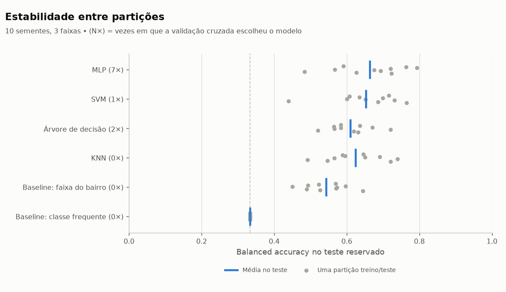

**Análise:**
- O modelo escolhido pela validação cruzada superou o baseline de bairro em 9 de 10 partições, com ganho médio
  de ~0,10.
- MLP e SVM se sobrepõem e não há diferença conclusiva entre eles.
- Numa única partição, a balanced accuracy varia cerca de ±0,09. Na partição de semente 42, o baseline de bairro
  teve 0,67 no teste, acima dos modelos, embora sua média seja 0,54. Concluir a partir de uma única partição
  seria um erro.
- Quase todos os erros caem na faixa vizinha. **A faixa média é a mais difícil:** na semente 42, o recall foi
  0,60 (baixa), 0,39 (média) e 0,71 (alta), o que é esperado em classes ordenadas.
- Com 4 faixas o ganho sobre o acaso é proporcionalmente maior, mas os erros graves sobem para 6–8%. Por isso
  3 faixas é a configuração principal.
- **Importância por permutação:** a área domina. No MLP com 4 faixas, a importância se distribui entre distância
  ao centro, área, bairro e banheiros.

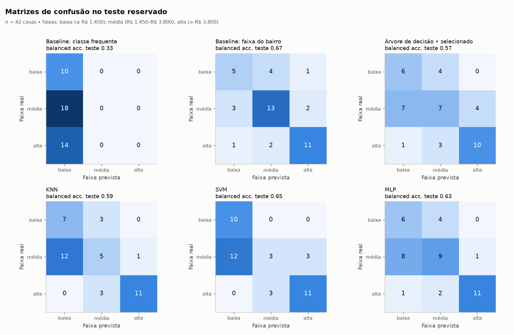

Detalhes, grades de hiperparâmetros e limitações em [classificacao.md](classificacao.md).

## 8. Regressão e módulos adicionais
### 8.1 Regressão do valor em reais
**Alvo:** o log do aluguel, por causa da forte assimetria (seção 19 da apostila). As previsões voltam para reais
antes de qualquer métrica.

**Protocolo:** os mesmos atributos, partições por imóvel, validação cruzada agrupada e 10 repetições da
classificação. Seleção pelo menor MAE médio na CV.

**Métricas:** MAE e MAPE (em reais e em porcentagem, fáceis de interpretar), RMSE e R².

**Intervalo de 80%:** vem dos quantis dos resíduos fora da amostra no treino, e sua cobertura é verificada no teste.

| Modelo (10 partições) | MAE na CV | MAE no teste (média ± dp) | MAPE no teste | R² no teste | Escolhido |
|---|---|---|---|---|---|
| **SVR** | **R$ 1.279** | **R$ 1.426 ± 458** | **31%** | **0,58** | **10×** |
| Regressão linear (Ridge) | R$ 1.411 | R$ 1.672 ± 508 | 37% | 0,43 | 0× |
| KNN | R$ 1.479 | R$ 1.713 ± 516 | 36% | 0,44 | 0× |
| Árvore de decisão | R$ 1.502 | R$ 1.736 ± 384 | 42% | 0,42 | 0× |
| Referência: mediana do bairro | R$ 2.014 | R$ 2.163 ± 422 | 65% | 0,23 | — |
| MLP | R$ 8.716 | R$ 25.565 ± 35.636 | 156% | negativo | 0× |

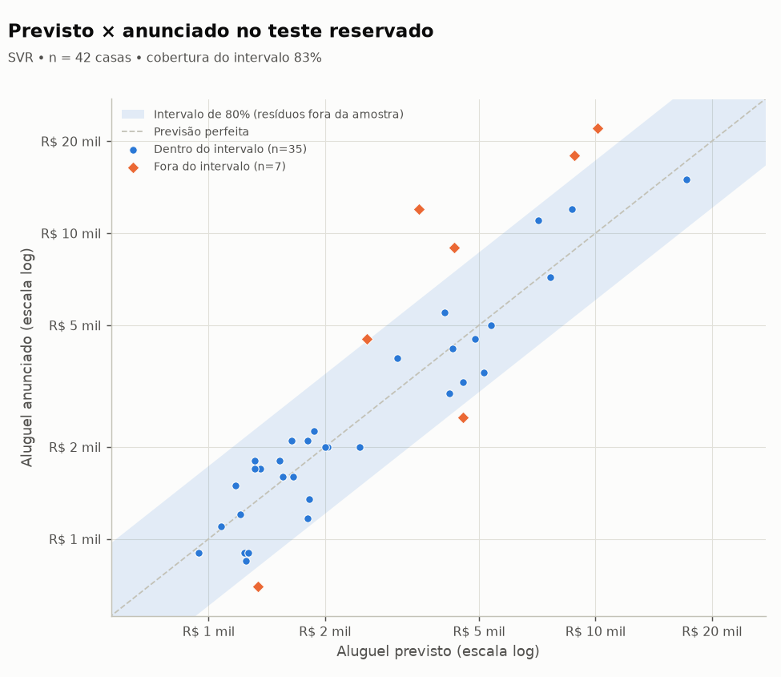

**Resultados:**
- O SVR superou a referência por bairro em todas as partições.
- O intervalo de 80% cobriu em média 81% das casas do teste (de 65% a 96%). Ele é largo: a previsão × 0,64 a × 1,67.
- O MLP é instável com o alvo em log: pequenas extrapolações viram valores absurdos em reais.

**Resíduos:**
- Há regressão à média: as casas da faixa baixa são superestimadas (+36%) e as da alta subestimadas (−27%), o que
  indica atributos ausentes de padrão e acabamento.
- Os maiores erros são casas atípicas, por exemplo 760 m² no Centro a R$ 22.000 com previsão de R$ 10.117.

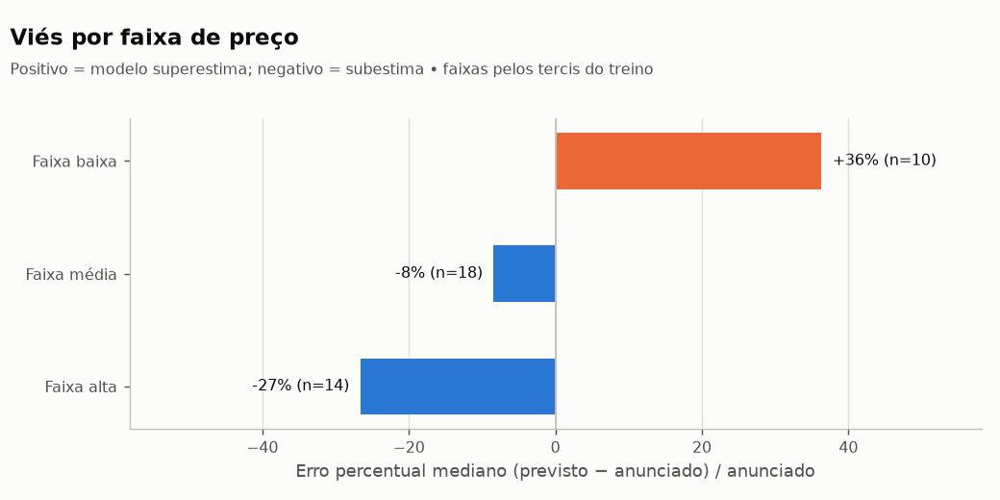

Detalhes em [regressao.md](regressao.md).

### 8.2 Módulos adicionais
Funcionalidades que a apostila lista como adicionais:
- **Anunciado × estimado:** cada casa é prevista por um modelo que não a viu (validação cruzada agrupada). 149 casas
  estão dentro do padrão, 31 anunciadas acima e 28 abaixo da faixa prevista. Isso **não indica erro nem fraude**:
  são candidatas a imóvel especial, anúncio incorreto ou oportunidade (seção 9.4 da apostila).
- **Busca de imóveis semelhantes:** as 5 casas anunciadas mais parecidas em área, quartos e distância, com a
  mediana de aluguel delas como segunda referência.
- **Fatores associados à previsão** (importância por permutação) e **exportação** de relatórios e de anúncios
  filtrados em CSV.

## 9. Sistema e visualizações geográficas
**Arquitetura.** Pacote Python `imoveis_pg` com comandos de linha:

| Comando | Função |
|---|---|
| `collect` | Coleta e geocodificação |
| `merge` | Une as fontes |
| `analyze` | Qualidade e EDA |
| `cluster` | Agrupamento |
| `classify` | Classificação |
| `regress` | Regressão do valor |
| `export-base` | Base processada pública |
| `build-app` | Treina os modelos finais, fora da interface |
| `app` | Abre o Streamlit |

O app não treina nada durante a navegação; ele lê artefatos gerados antes (modelo, anúncios sem endereço,
bairros e metadados). Bibliotecas: pandas, numpy, scikit-learn, geopandas, folium e Streamlit.

**Mapa do mercado:**
- bairros coloridos pela mediana do aluguel ou do R$/m², em quatro classes por quartis, com legenda de
  indicador, unidade e método;
- **bairros com menos de 5 anúncios em cinza tracejado**, como baixa confiabilidade (seção 8.2 da apostila);
- pontos cheios para localização exata e vazados para aproximada;
- filtros de finalidade, tipo, uso, bairro, faixa de aluguel, quartos e perfil, que recalculam os indicadores.

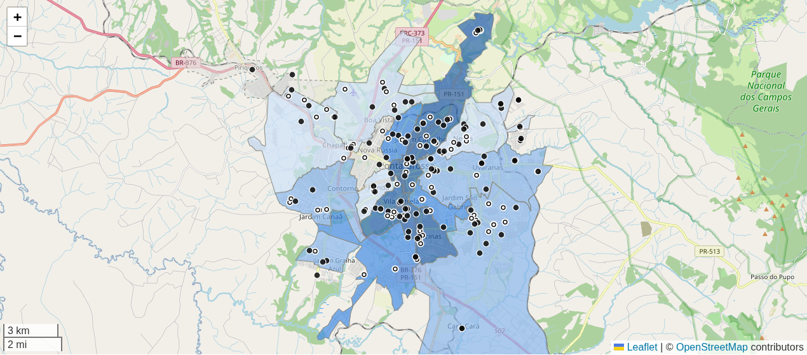

**Simulador:**
- o usuário clica no mapa, informa área, quartos, banheiros, vagas, suítes e tipo;
- o app devolve o **aluguel estimado com intervalo de 80%** (SVR), a faixa e a probabilidade de cada faixa
  (MLP), o bairro oficial, o perfil semelhante e as casas parecidas;
- o valor só é exibido porque o modelo erra menos que a mediana do bairro (R$ 1.201 contra R$ 2.039, fora da
  amostra);
- há avisos para ponto fora da cidade, baixa cobertura, extrapolação e **discordância entre os modelos ou com os
  comparáveis**. Uma diferença de até 10% na divisa entre faixas não gera aviso.

O teste no navegador revelou um erro de codificação, depois corrigido: o usuário informar "0 suítes" gerava
uma entrada que o modelo nunca viu no treino, onde a ausência do campo representa "sem suíte".

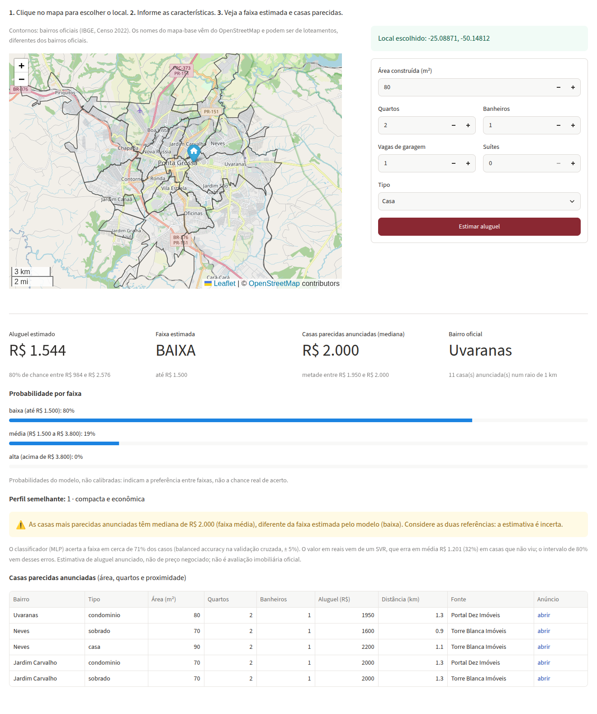

## 10. Discussão: limitações, vieses e implicações
- **Representatividade:** quatro imobiliárias numa única data. Aluguéis informais, de portais nacionais e de
  proprietários diretos não estão na base; ela tende a representar o mercado intermediado por imobiliárias e a
  concentrar-se nos bairros em que elas atuam.
- **Tamanho:** 208 casas; as métricas têm incerteza de cerca de ±0,09.
- **Ausências desiguais entre fontes:** o Portal Dez omite banheiros em metade dos anúncios. Os perfis usam 140
  casas, o que pode sub-representar essa fonte.
- **Localização:** 95 casas têm posição aproximada, com erro de dezenas de metros a quilômetros. Os nomes de bairro
  dos anúncios nem sempre coincidem com a malha oficial: 22 divergências, a maioria perto da divisa.
- **Anúncio ≠ negócio:** o alvo é o aluguel pedido, não o pago. O sistema **não é ferramenta oficial de
  avaliação imobiliária**, e o app diz isso.
- **Ética e privacidade:**
  - coleta só do que é público e permitido;
  - nenhum dado pessoal guardado;
  - endereços fora do app;
  - páginas brutas, que contêm nomes de corretores, não são versionadas nem publicadas.

## 11. Conclusão e trabalhos futuros
O projeto entrega um processo completo e reprodutível, da coleta ao mapa interativo. A localização importa: o
R$/m² mediano varia de cerca de 15 a 33 entre bairros, e localização e distância ao centro estão entre os
atributos usados pelos melhores modelos. Mas o bairro sozinho é um indicador grosseiro: os modelos que combinam
local e características superaram o baseline por bairro, e um mesmo bairro tem polos de preço diferentes. Os
perfis de casas são estáveis e interpretáveis.

**Trabalhos futuros:**
- ampliar as fontes (Kikina, Conceito) e repetir a coleta em várias datas, para análise temporal;
- calibrar as probabilidades do classificador e ajustar o intervalo da regressão por faixa de preço;
- coletar atributos de padrão e acabamento, que faltam para reduzir o viés da regressão nos extremos;
- verificar manualmente os anúncios fora do padrão.

### Respostas às perguntas orientadoras (seção 21 da apostila)
| Pergunta | Resposta com base nos dados |
|---|---|
| A localização continua importante depois de controlar área e quartos? | Sim, de forma moderada. O R$/m² varia de 15,50 a 33,30 entre bairros, e no MLP com 4 faixas a distância ao centro e o bairro estão entre os atributos mais importantes, junto da área. |
| O preço por m² varia de forma consistente entre os bairros? | Em parte. As medianas diferem, mas a dispersão dentro dos bairros é alta, e há polos distintos no mesmo bairro (Cara Cara: 22,50 e 27,90). |
| Os grupos correspondem às divisões oficiais? | Os perfis de casa não (ARI 0,04). As concentrações espaciais ficam dentro dos bairros quando o raio é pequeno, mas não os descrevem por inteiro. |
| Que atributos diferenciam regiões caras das acessíveis? | Tamanho, banheiros e suítes: o alto padrão é a maior fatia no Centro (60%) e na Estrela (50%); Neves, Boa Vista e Chapada têm mais de 80% de casas compactas. |
| Os modelos erram mais para baratos, intermediários ou alto padrão? | Na classificação, para os intermediários (recall 0,39 na partição principal). Na regressão, o erro em reais cresce com o preço (R$ 297 na faixa baixa, R$ 3.509 na alta) e há viés de regressão à média: +36% nas baratas, −27% nas caras. |
| Há diferença entre fatores do aluguel e da venda? | Fora do escopo: a base é só de locação. |
| Quais regiões têm resultados pouco confiáveis? | Nova Rússia e Vila Ildemira (menos de 5 casas), Olarias e Colônia Dona Luíza (5 e 6 casas), e anúncios com localização aproximada. |
| Os anômalos são erros, imóveis especiais ou oportunidades? | 59 casas fogem da faixa prevista; distinguir os casos exige verificar cada anúncio, e o app as lista com link. |

## 12. Referências
- BREIMAN, L. Random forests. *Machine Learning*, v. 45, p. 5–32, 2001.
- GÉRON, A. *Hands-On Machine Learning with Scikit-Learn, Keras, and TensorFlow*. 3. ed. O'Reilly, 2022.
- HASTIE, T.; TIBSHIRANI, R.; FRIEDMAN, J. *The Elements of Statistical Learning*. 2. ed. Springer, 2009.
- IBGE. *Cadastro Nacional de Endereços para Fins Estatísticos (CNEFE): Censo Demográfico 2022*. Rio de Janeiro:
  IBGE, 2024. Arquivo `4119905_PONTA_GROSSA.zip`.
- IBGE. *Malha de setores censitários: bairros, Censo Demográfico 2022*. Rio de Janeiro: IBGE, 2024. Arquivo `PR_bairros_CD2022.gpkg`.
- JAMES, G. et al. *An Introduction to Statistical Learning*. 2. ed. Springer, 2021.
- PEDREGOSA, F. et al. Scikit-learn: Machine Learning in Python. *JMLR*, v. 12, p. 2825–2830, 2011.
- Apostila do Projeto Integrador: *Sistema Inteligente de Mapeamento e Estimativa de Preços de Imóveis*.

## Apêndice A. Reprodução
Para só usar o sistema, `python -m imoveis_pg demo` prepara o que faltar e abre o app (ver README).
A sequência completa que gerou os números deste relatório:

```bash
python -m pip install -r requirements-tested.txt && python -m pip install -e ".[dev]"
for f in torreblanca portaldez granada vilanova; do
  python -m imoveis_pg collect $f --output data/${f}_2026-11-09.csv
done
python -m imoveis_pg merge data/*_2026-11-09.csv --output data/base_2026-11-09.csv
python -m imoveis_pg analyze data/base_2026-11-09.csv --output reports/base-2026-11-09 --bairros data/raw/ibge/PR_bairros_CD2022.gpkg
python -m imoveis_pg cluster data/base_2026-11-09.csv --output reports/agrupamento-2026-11-09
python -m imoveis_pg classify data/base_2026-11-09.csv --output reports/classificacao-3faixas-2026-11-09 --repeticoes 10
python -m imoveis_pg regress data/base_2026-11-09.csv --output reports/regressao-2026-11-09 --repeticoes 10
python -m imoveis_pg build-app data/base_2026-11-09.csv --output data/app/2026-11-09
python -m imoveis_pg app --artefatos data/app/2026-11-09
python -m pytest -q   # 123 testes
```
A base processada pública está em `data/processado/base_2026-11-09.csv` (sem endereço; coordenadas arredondadas a ~100 m).
Uma nova coleta gera dados de outra data. Para reproduzir exatamente estes resultados, use o cache de páginas
em `data/raw/` com `--offline`. Cada relatório grava sementes, hiperparâmetros, versões e o SHA-256 da entrada
no `manifest.json`.

## Apêndice B. Documentos de apoio
[coleta.md](coleta.md) · [dados.md](dados.md) · [dicionario.md](dicionario.md) · [classificacao.md](classificacao.md)
· [regressao.md](regressao.md) · [agrupamento.md](agrupamento.md) · [app.md](app.md) · [gestao.md](gestao.md)
